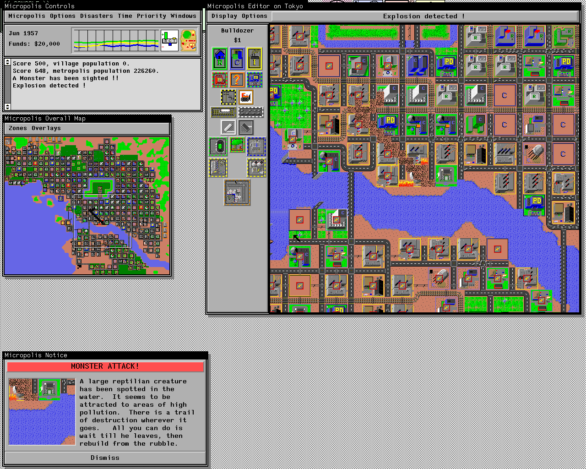
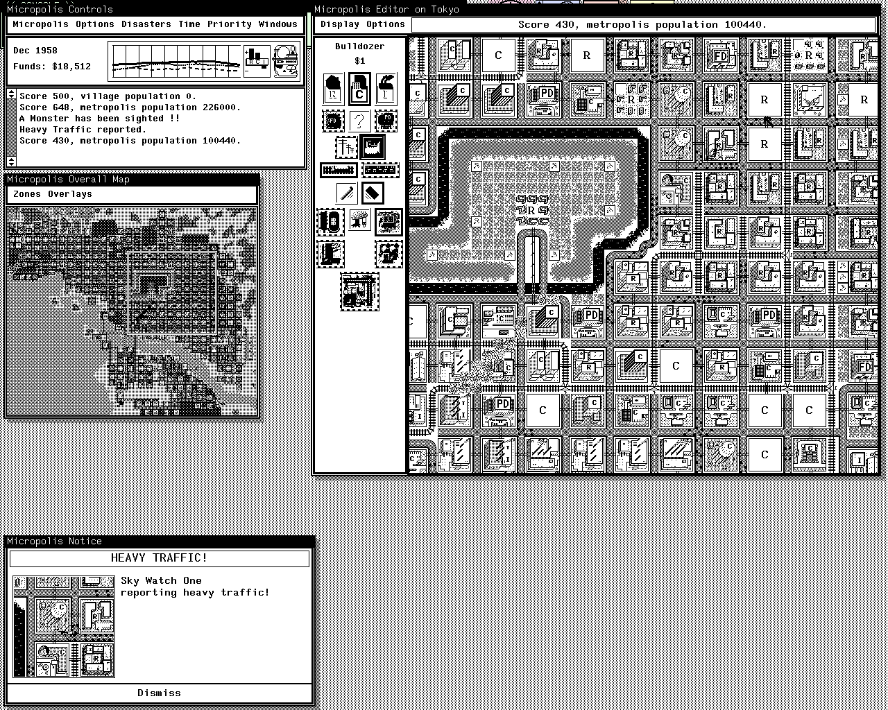
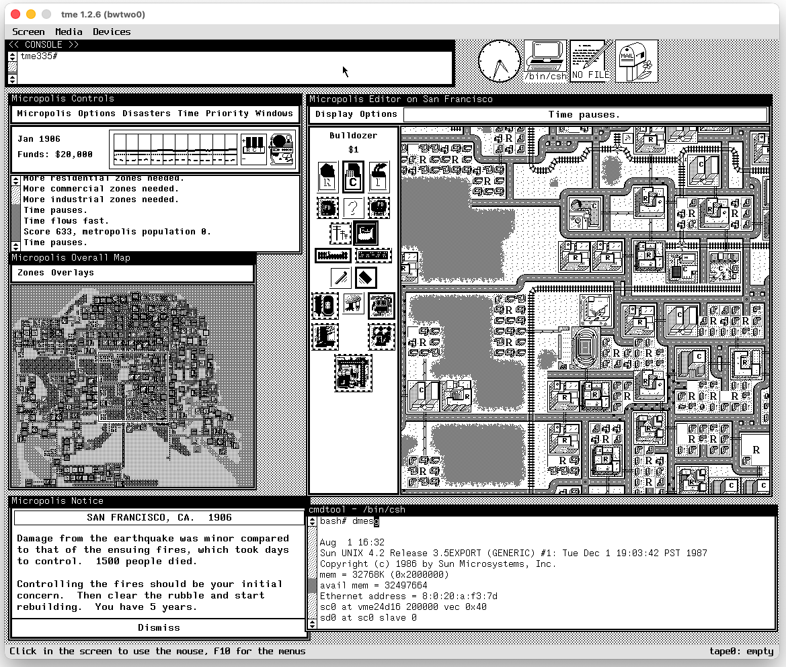

# Micropolis for SunView

A port of Micropolis, the open source city simulator, to
[SunView](https://en.wikipedia.org/wiki/SunView) on SunOS 4.1 and
SunOS 3.5.
It is not X11: it runs right in SunView, on the console of an old
Sun workstation.

The game engine comes from
[Micropolis Legacy](https://github.com/tenox7/micropolis-legacy).
This port has a new SunView front end written in K&R C, with the
layout of DUX SimCity for Unix: separate windows for the controls,
the overall map, the editor, graphs, budget, evaluation and notices.
It uses the art, sounds, texts and cities of the DUX SimCity demo.

This is a modified version of Micropolis; it is not the original
program.



It also has a black and white (1 bit) mode, for Sun workstations
with a monochrome framebuffer:



## Installation

All in one:
[micropolis-sunview.tar.lz](https://files.42718.net/mirror/tenox/apps/simcity/micropolis-sunview.tar.lz)
has both binaries, the DUX SimCity demo files and the source in one
`SimCity` folder. Unpack it with `lzip -d`, copy
`micropolis-sunview.tar` to the Sun, and unpack it there with
`cd /usr; tar xf micropolis-sunview.tar` (or in `/usr/local`).
Its `README.micropolis` tells the rest.

Or step by step:

1. Download the demo of
   [DUX SimCity for Unix](https://web.archive.org/web/19970714233306/http://www.dux.com/demo.html),
   also mirrored [here](http://osarchive.org/apps/simcity) and
   [here](http://tenox.pdp-11.ru/apps/simcity/).
2. Unpack it to a folder, typically `/usr/SimCity`.
   It has the `images`, `res` and `cities` folders that the game needs.
3. Download `micropolis-sunos4-sparc` from the
   [releases](https://github.com/tenox7/micropolis-sunview/releases).
   It is a static binary built on SunOS 4.1.4, so it needs no shared
   libraries and should run on other SunOS 4.1.x SPARC systems too.
   For SunOS 3.5 on a Sun-3, download `micropolis-sunos35-sun3`.
4. Start SunView, then from a shell tool:

```
chmod +x micropolis-sunos4-sparc
SIMHOME=/usr/SimCity ./micropolis-sunos4-sparc
```

`SIMHOME` is not needed when the game folder is `/usr/SimCity`,
`/usr/local/SimCity`, `/opt/SimCity`, the current folder or the
parent folder.

## Options

```
micropolis [-l level] [-s scenario] [-seed n] [-mono] [-nosound] [-debug] [city.cty]
```

| Option | Meaning |
|---|---|
| `-l 0`, `-l 1`, `-l 2` | game level: easy, medium, hard |
| `-s 1` ... `-s 8` | start a scenario (Dullsville, San Francisco, Hamburg, Bern, Tokyo, Detroit, Boston, Rio de Janeiro) |
| `-seed n` | make a new map from this number |
| `-mono` | black and white (1 bit) art |
| `-nosound` | no sound |
| `-debug` | log what the game does to stderr |
| `city.cty` | load a saved city |

Usual SunView window options (`-Wp`, `-Ws` and so on) work too.

## Black and white

The game picks black and white by itself on a 1 bit screen (bwtwo).
Use `-mono` to get it on a color screen.

It uses the black and white art that DUX made for monochrome displays:
the black and white tiles (`tilesbw.xpm`), the gray small tiles for
the map (`res/hexa.388`), the mono colors in the DUX images, and
patterns for the map overlays.

## Sound

Sound effects play through `/dev/audio`.
Set `AUDIODEV` to use another device.

## SunOS 3.5

The same source builds on SunOS 3.5 (Sun-3) with `make sunos3`.
SunOS 3.5 has no alerts, STREAMS, `<stdlib.h>` or `<dirent.h>`, so:

- Yes or no questions (such as Quit) come up in a small window
  with two buttons, not in an alert.
- There is no sound: Sun-3 machines have no `/dev/audio`.

Menus open with any mouse button, as on SunOS 4.1.



## Building

You need SunOS 4.1.x or 3.5 with the SunView libraries
(`libsuntool`, `libsunwindow`, `libpixrect`).

```
cd src
make                    # the SunOS /bin/cc (K&R)
make CC=gcc             # or gcc
make LDFLAGS=-Bstatic   # static binary, like the release
make sunos3             # SunOS 3.5 (Sun-3), its /bin/cc
```

SunOS 3.5 has no shared libraries, so its binary is always static.

## Tested on

- SunOS 4.1.4 on a SPARCstation 5 (sun4m) with a cgthree, 8 bit
  color at 1280x1024
- `-mono` on the same 8 bit screen
- SunOS 3.5 on an emulated Sun-3/160 (TME) with a bwtwo, 1 bit at
  1152x900

Not tested yet on a real 1 bit framebuffer (bwtwo).

## Legal

- License: GNU GPL v3 with the additional terms from Electronic Arts,
  see [LICENSE](LICENSE)
- Copyright (C) 1989 - 2007 Electronic Arts Inc.
- No trademark rights are granted. This project has no affiliation
  or association with Electronic Arts Inc.
- The DUX SimCity demo files (art, sounds, cities) are not part of
  this repository.
